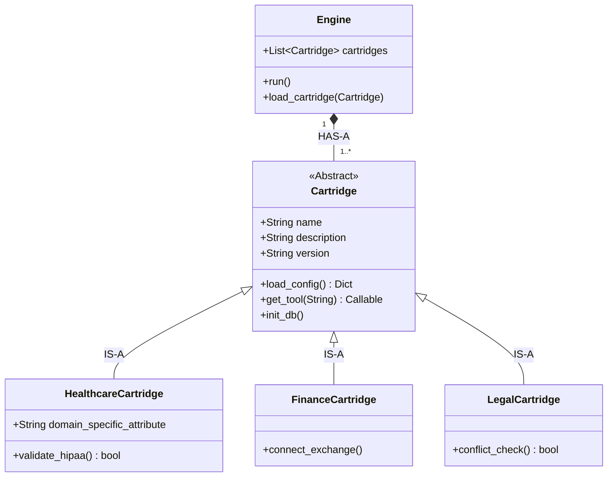

# Cartridge Domain Model

This artifact formally defines the `Cartridge` as a first-class Entity in the Domain Model, highlighting its Object-Oriented relationships.

### Relationship Breakdown:
*   **HAS-A (Composition):** The core `Engine` HAS-A `Cartridge`. It cannot function without one loaded.
*   **IS-A (Inheritance):** A `HealthcareCartridge` IS-A `Cartridge`. It inherits all the base methods (like `load_config`), but extends it with its own domain-specific behaviors (like `validate_hipaa()`).
